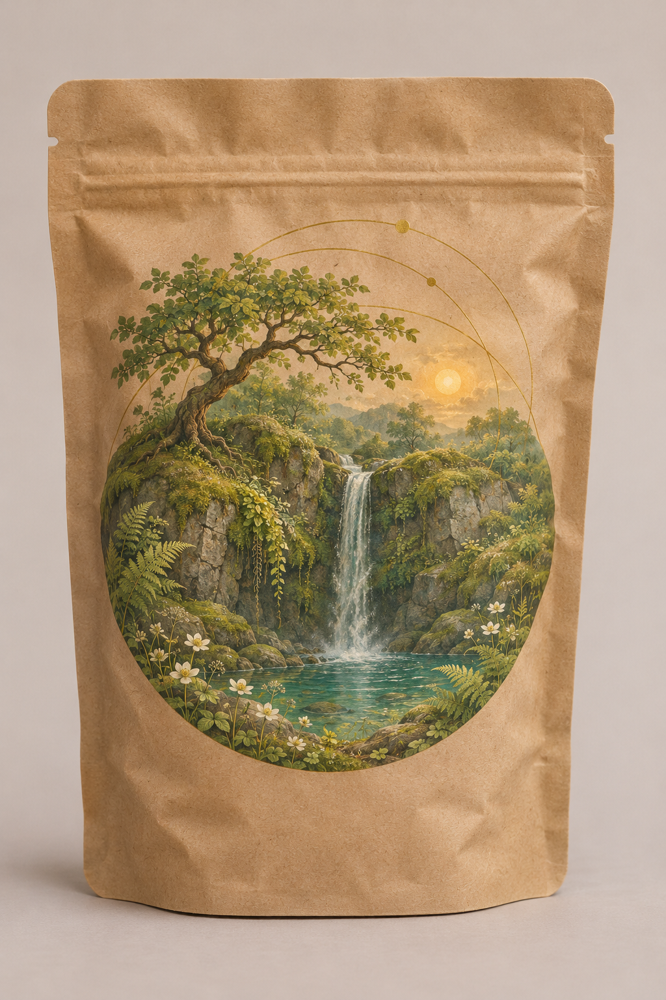
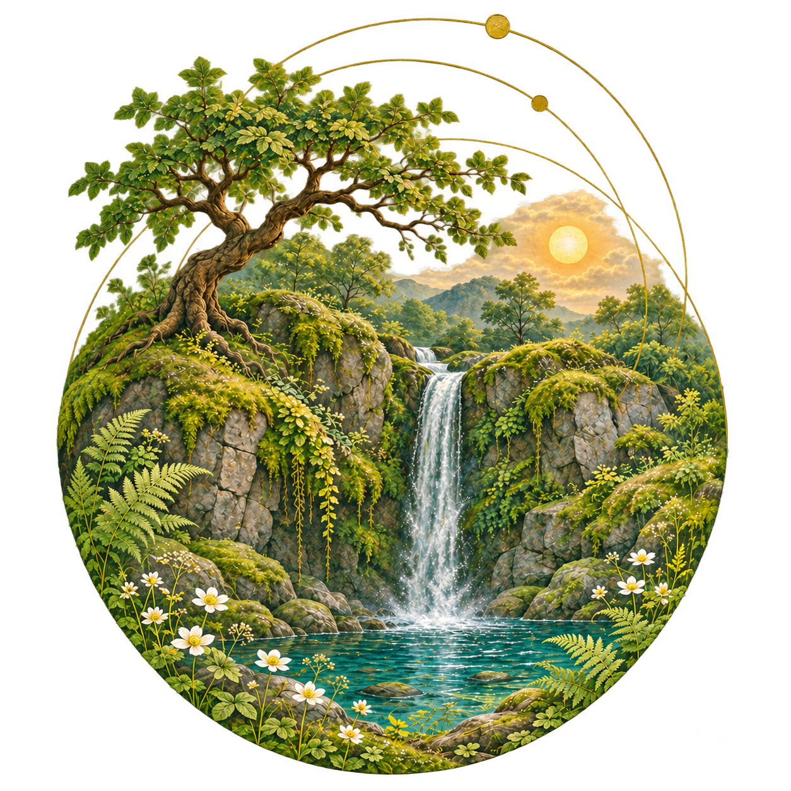
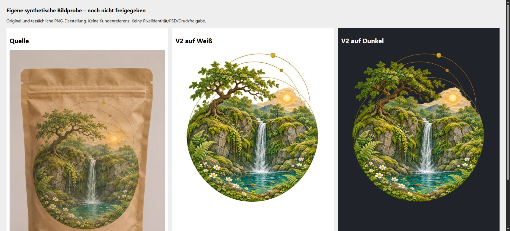

# Synthetische KI-Bildrekonstruktionsprobe

Eigene KI-erstellte Vorher-Nachher-Probe von Mara Digital / Timo Laß. Das Ausgangsbild ist ein eigens generiertes fiktives Verpackungsmockup. Es enthält keine Kundenbilder, echte Produktmarke oder fremde Fotos. Die Bearbeitung wurde vollständig mit dem eingebauten Imagegen-Werkzeug ausgeführt; Prompts stehen in [prompts.json](prompts.json).

## Vorher

## Nachher

Das Motiv wurde aus dem fiktiven Mockup als eigenständiges PNG rekonstruiert. Baum, Wasserfall, Felsen, Teich, Blüten und Goldbögen folgen der Ausgangskomposition näherungsweise. Details, Farben und Proportionen können abweichen. Es handelt sich um eine generative Rekonstruktion, keine pixelidentische Freistellung oder nachgewiesene verlustfreie Super-Resolution.

## Tatsächlich geprüft

- Ausgangsdatei: 1024 × 1536 Pixel. Ergebnisdatei: 1254 × 1254 Pixel, PNG RGBA mit 8 Bit je Kanal.
- Das unveränderte Ergebnis wurde in einem normalen Browser auf weißem und dunklem Hintergrund angesehen. In dieser Darstellung erscheinen Blätter und Goldlinien bei der gezeigten Größe sauber freigestellt.
- Die separate Tool-Vorschau zeigte gelbe/rote Randbereiche, die im Browser nicht sichtbar waren. Die Ursache dieser unterschiedlichen Darstellung wurde nicht bestimmt; eine universelle Darstellungsgarantie wird daraus nicht abgeleitet.
- Eigene synthetische Probe; keine Kundenreferenz, kein Auftrag und keine Umsatzbestätigung. Keine menschliche Endkontrolle: Erstellung und visuelle Prüfung erfolgten durch KI.

## Lieferumfang und Grenzen

Dies sind PNG-Dateien und der Prüfbeleg. Es werden keine editierbare PSD, getrennte Retuscheebenen, 4K-Auflösung, druckfertigen Daten, selektiver Weißdruck oder eine Kundenabnahme behauptet. Die PNG-Probe liegt bewusst vor einer möglichen gesonderten Vereinbarung über einen kleinen bezahlten Bildtest vor. Für fremde Kundenvorlagen müssen die nötigen Ausgangsrechte und das gewünschte Ergebnis vor Beginn geklärt sein.

Es wurden keine zusätzlichen Bild- oder Schriftlizenzen eingebunden. Exklusivrechte oder gesetzlicher Urheberrechtsschutz an rein KI-generierten Motiven werden nicht zugesichert. Konkrete kommerzielle Nutzungsbedingungen für einen Kundenauftrag sind gesondert zu vereinbaren.
